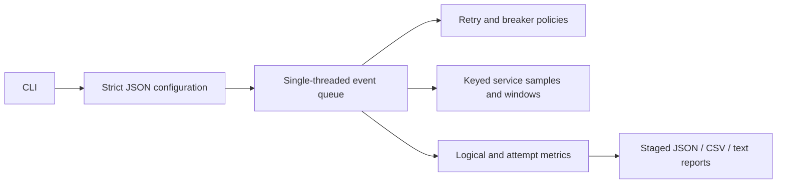

# Architecture and event lifecycle

Domain objects are values in `model.hpp`. The configuration boundary checks all externally
supplied data before the engine allocates workload state. The public `simulate` function
revalidates programmatically constructed scenarios too. Reporting and CLI depend on the
engine, while the engine has no filesystem or terminal dependency.

Time is `std::chrono::milliseconds` with signed integer representation and maximum supported
value 10^12 ms. Inputs and derived arrival/deadline/late-completion/breaker horizons are
checked using exactly request_count − 1 arrival intervals. Configuration reads are capped
at 1 MiB even if a file grows after its initial size check; parsing enforces a depth limit of 64.
Backoff doubling caps before multiplication; time addition never wraps.

## Ordering

An event is a value containing time, kind, a monotonically increasing insertion sequence,
request ID and optional attempt index. The min-priority queue orders by **(time, kind,
sequence)**. At equal times, kinds execute in this order:

1. End-to-end deadline.
2. Attempt timeout.
3. Downstream completion.
4. Arrival or retry start.

Within each kind insertion order wins. Initial requests are inserted in ascending zero-based
ID order. Newly inserted zero-latency completions precede other starts at that timestamp.
This makes simultaneous arrivals, zero delays, half-open probes and deadline ties explicit.
An attempt never starts at or after its deadline. A service completion exactly at its timeout
is a timeout. A completion exactly at the request deadline cannot succeed.

## Lifecycle

Each request gets an arrival/start event and an absolute deadline event. Admission either
finishes the request with circuit-open rejection or starts downstream work and records its
sampled latency/error. Each started attempt gets one completion and one timeout event.
The timeout is `min(per_attempt_timeout, remaining_request_budget)` after its start.

The first eligible settlement records success, service error or timeout, releases the request's
active-attempt reference and updates the breaker using the admission-generation token. Errors
and timeouts alone are retryable. With attempts remaining, schedule the policy delay. If a
retry would start at/after the deadline, keep the request pending until its deadline and finish
as `deadline`. When attempts are exhausted before the deadline, finish immediately as the
last error/timeout. A deadline during active work records an attempt timeout and final deadline.
A circuit rejection is final immediately and never schedules another retry.

Logical cancellation **does not cancel downstream work**. Every completion event drains, even
after a timeout or request finalization. Settled flags make later completions observable as
`late_completions` without changing metrics, outcomes or breaker state. Stale timeout/deadline
events are harmless no-ops. The event loop may process such no-ops beyond logical completion;
reported completion time uses final outcomes, not the queue's last timestamp. Drain time uses
actual service-completion events and is at least logical completion time.

Requests and attempts live in engine-owned vectors until the queue is empty. Events hold
indices, never references/pointers into a growing vector. No callbacks capture object addresses;
there is no concurrency, manual allocation or lifetime shared across runs. Every request must
finish once. The engine checks the final request partition, exact attempt accounting
(successes + observed errors + timeouts = attempts), one late completion per timeout, rejection
counts, retry counts, monotonic time and event bounds.

## Randomness and fair comparison

A specified SplitMix64 integer mixer and rejection sampler generate bounded integers, avoiding
`std::uniform_*_distribution`. Unsigned 64-bit wraparound is intentional. Service stream state
is `mix(seed XOR 0x5345525649434501 XOR (uint64(request_id)<<32) XOR attempt_number)`.
Latency sampling consumes one bounded draw (including fixed latency's zero-width range),
then an error draw uses the top 53 bits of the next word scaled by 2^-53. Error probability
comparison is strictly `<`; probabilities zero and one are exact endpoints.

Policy jitter uses a separate mutable stream initialized with
`mix(seed XOR 0x4a49545445520001)`. It cannot consume service randomness. Request IDs start at
zero; attempt numbers start at one. Each strategy starts fresh with the same seed. Service
uniform values for the same request/attempt are coupled across strategies, **but the selected
window can differ because the attempt starts at a different simulated time**. Different uniform
latency bounds also transform the same draw differently.

Reproduction is guaranteed for identical effective configuration, strategy and application
version on the same toolchain/platform with default floating-point settings. Integer RNG
algorithms are specified and golden-tested, supporting portability, but no cross-platform
bit-for-bit report guarantee is made: probability parsing, floating-point arithmetic/formatting,
compiler/library versions and text encodings can differ. There is no wall-clock input.

## Bounds

At most 100,000 requests, 20 attempts per request, 1,000,000 potential attempts, 1,000 windows,
1 MiB configuration and 100,000 trace entries per strategy are accepted. Total scheduled
entries are bounded by `requests * (2 + 3 * max_attempts)`; the engine additionally enforces
4,200,000 processed events. Trace overflow truncates recording, never the simulation. Queue,
request, attempt and metric storage are bounded by these limits, though a maximally allowed
run can still need hundreds of MiB. Window lookup is linear over at most 1,000 windows.

## Report writes

Create missing parent directories; acquire an exclusive sibling `<destination>.failurelab-lock`
directory. Write all three files into `lock/pending`, check write/close status, then rename that
complete directory into place on the same filesystem. Existing outputs require `--overwrite`,
a directory, and a regular `failurelab-report.json` marker. Symbolic-link destinations are
rejected. Existing report directories may contain only the three generated filenames, each a
regular file; extra notes, subdirectories or internal symlinks cause a clean refusal. With overwrite, move the old directory into `lock/previous`, finalize the new report,
then clean the backup. A finalization error restores the backup; if restoration also fails,
preserve the lock and return its recovery path. RAII cleans temporary files on ordinary errors.

This is cooperative locking, not defense against a malicious concurrent filesystem writer.
Do not modify the destination externally during a run. A new directory's rename is atomic on
ordinary local Linux/macOS filesystems. Overwrite has a short period with no destination and
is **not** an atomic directory exchange. No `fsync`/power-loss durability is promised; a killed
process can leave a lock/backup requiring manual recovery. Network filesystems may provide
weaker guarantees. These limits are intentional for a local portfolio application.
