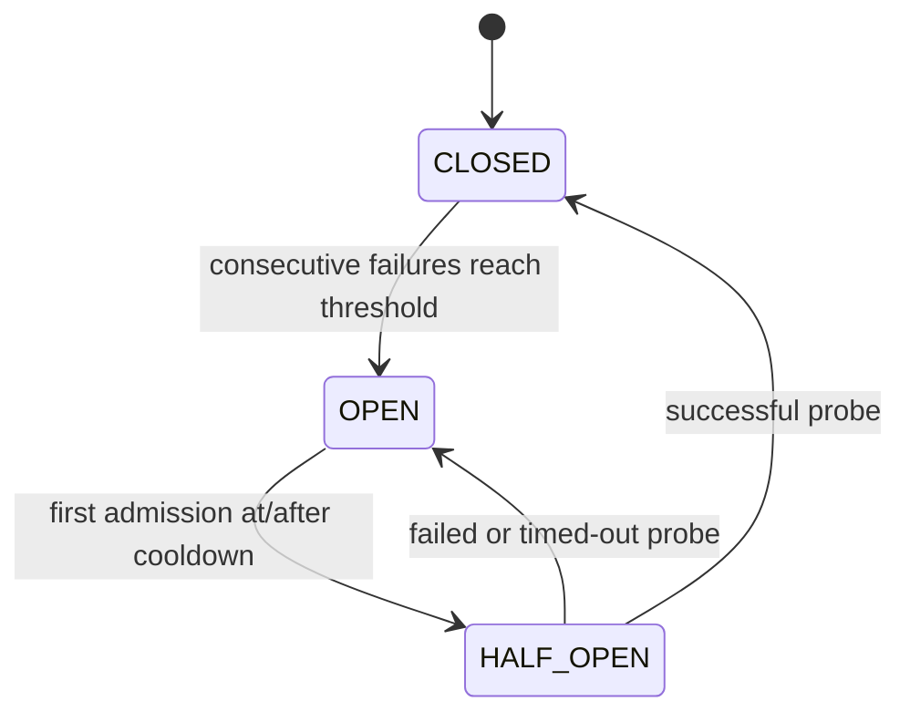

# Circuit-breaker semantics

The breaker is shared by all logical requests in one run. It is independently testable through
`admit` and `settle`, with a generation token returned by successful admission.

**CLOSED:** admit concurrent simulated calls. A settled success resets the failure streak.
A settled service error or timeout increments it. When the threshold is reached, open the
breaker and record an absolute cooldown expiration. A deadline cutting off an active attempt
counts as an attempt timeout. Deadline expiry while merely waiting has no breaker effect.

**OPEN:** reject admissions without a downstream attempt. At the first admission at or after
cooldown expiration, enter HALF_OPEN and admit exactly one probe. Transition is lazy, so time
past cooldown still counts as OPEN until an admission occurs. No timer/probe is generated
without demand.

**HALF_OPEN:** reject all admissions while the single probe is unsettled, including simultaneous
requests ordered later in the queue. A successful probe closes the breaker, clearing its
streak. A failed/timed-out probe reopens with a fresh cooldown. With zero latency the probe
completion can precede the next arrival at the same timestamp, allowing that arrival after
the successful close. With positive latency, simultaneous arrivals observe the in-flight probe.

Every transition increments a generation counter. A completion admitted in an earlier
CLOSED/HALF_OPEN generation cannot update the current state, even if it is that attempt's
first settlement. Within the current CLOSED generation, settlements count in event order.
Late completions of already settled attempts never call `settle` again. Fast rejections do
not increment the failure streak or schedule retries. They produce final `circuit_open`.

Recorded transitions are `(at_ms, from, to)`. State duration begins CLOSED at t=0 and ends at
the last logical final outcome; it includes idle intervals, excludes later downstream drain,
and sums exactly to completion duration. Non-breaker strategies report no state durations.

A breaker trades availability and recovery detection speed for fewer calls to an unhealthy
dependency. A long cooldown may reject healthy traffic after service recovery; a short one
may probe repeatedly during an outage. This service model has no capacity feedback, so fewer
calls cannot be interpreted as preventing overload or improving downstream response time.
